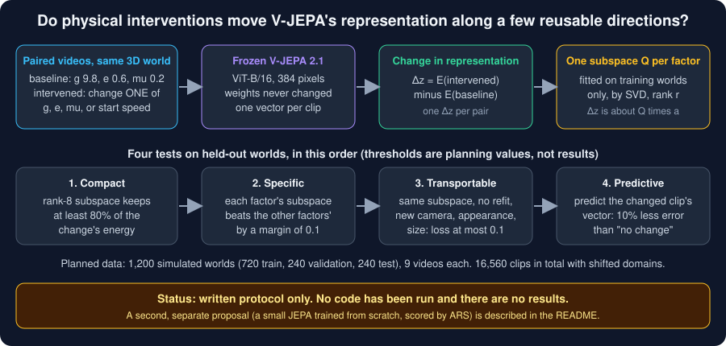

# Mechanistic interpretability of V-JEPA 2.1

**Question:** does the frozen V-JEPA 2.1 video model represent physical mechanisms (gravity, bounce, friction) in a compact, factor-specific and reusable form?

**Status: written protocol only. No code has been run and there are no results.** This repository holds two experiment proposals.

## The two proposals

| | Proposal 1: 3D intervention study | Proposal 2: abstraction emergence |
| --- | --- | --- |
| Question | Do controlled changes to gravity `g`, restitution `e` or friction `mu` move V-JEPA's representation along compact, specific, transportable subspaces? | Under what training conditions does a small JEPA, trained from scratch, learn a gravity mechanism that improves prediction in new states and phenomena? |
| Model | Frozen V-JEPA 2.1 ViT-B/16, 384 px | Small JEPA trained from scratch (not a V-JEPA reproduction) |
| World | PyBullet physics, Blender EEVEE rendering; 1 kg sphere, radius 0.15 m; baseline `g` 9.8, `e` 0.6, `mu` 0.2 | Sphere in free flight, radius 0.10 m, `g` of 4, 9 or 14 m/s², 96 x 96 RGB, 64 frames per episode |
| Planned data | Pilot of 120 worlds; main study 1,200 worlds (720 train, 240 validation, 240 test), 9 videos each; 16,560 clips with shifted domains | Pilot 5,000 clips; 20,000 clips per dataset replica; 500 test groups x 3 laws x 5 replicas |
| Main measures | Subspace retention, specificity margin, transport loss, error reduction over "no change" | Abstraction Recovery Score ARS = (L_S - L_J) / (L_S - L_O), compared with a state-only baseline and an oracle |
| Planning thresholds | Held-out rank-8 retention at least 0.8; specificity margin at least 0.1; transport loss at most 0.1; at least 10% error reduction over identity | ARS lower 95% bound above 0.20 with a valid gap, and a positive frozen-transfer gain |
| Documents | `01_3D_VJEPA_Research_Agenda.docx`, `02_3D_VJEPA_Mathematical_Framework.docx` | `docs/jepa-abstraction-experiment/` (four Markdown memos) |

All thresholds and sizes are **proposed defaults**. The documents say they must be frozen after a pilot and before the test set is opened.

## Status by category

| Category | Done | Pending (planned) | Not planned (gap) |
| --- | --- | --- | --- |
| **1. Research design, proposal 1** | Research agenda and mathematical framework written (research questions, estimands, null hypotheses, decision rules) | Freeze the design after the pilot | Amendment of the 1,200-world budget to a pilot-based power estimate is stated but not done |
| **2. Research design, proposal 2** | Four memos written: experiment plan, coding-agent instructions, stepwise execution plan, reporting specification | Freeze the Stage A-E definitions after the pilot | Companion files named in the memos (DOCX versions, XLSX dashboard, CSV templates, configuration contracts, reference utilities) are not in this repository |
| **3. Simulator and data** | - | Proposal 1: calibrate restitution and friction, 120-world pilot, 1,200-world main set. Proposal 2: matched-state generation, 5,000-clip pilot, 20,000-clip pretraining sets | No simulator code, no configuration files, no dataset manifests |
| **4. Model and feature extraction** | - | Proposal 1: load and check the pinned V-JEPA 2.1 checkpoint (milestone M0), extract final-layer features. Proposal 2: train the small JEPA, variants and baselines | No code, no pinned environment |
| **5. Analysis and statistics** | Methods specified: SVD subspaces, retention, specificity matrix, transport, matched-effect and null controls, ridge counterfactual operator, ARS, paired bootstrap, Holm correction | Run all of it after data exists | Power analysis from pilot variance is specified but not done |
| **6. Execution plan** | Proposal 1: milestones M0-M4 with owners and gates. Proposal 2: stepwise plan with Phases 0-4, Stages A-E, fresh confirmation and release, and go/no-go checkpoints | Phase 0 (proposal 2) and M0 (proposal 1) are the stated starting points; neither has started | No timeline. The compute budget is not set: checkpoint CP00 requires the maximum GPU-hours to be given an explicit value, and the documents claim no cost before hardware measurements |
| **7. Results** | - | Proposal 1: spectra, specificity heatmap, principal-angle plots, transfer curves, prediction comparisons. Proposal 2: Stage A-E results and a breaking-frontier study | None exist |
| **8. Beyond the proposals** | - | Listed as later extensions: layer-by-layer depth profiles, joint interventions, phase-specific subspaces, other object shapes, interacting bodies | The two proposals are not linked to each other, and neither is linked to the pilot in `V-JEPA-causal-geometry` |
| **9. Repository hygiene** | MIT `LICENSE` | - | The two proposal-1 documents are Word files, which GitHub cannot preview or diff. No code, tests or environment record |

## Files

| Path | Content |
| --- | --- |
| `01_3D_VJEPA_Research_Agenda.docx` | Proposal 1: purpose, research questions RQ1-RQ4, world and interventions, dataset, analysis, decision rules, work packages M0-M4 |
| `02_3D_VJEPA_Mathematical_Framework.docx` | Proposal 1: definitions and estimands (paired interventions, SVD subspaces, specificity, transport, counterfactual operator), assumptions, null hypotheses |
| `docs/jepa-abstraction-experiment/01_Research_Experiment_Plan.md` | Proposal 2: hypotheses H1-H5, world, JEPA model, ARS, Stage A-E matrix |
| `docs/jepa-abstraction-experiment/02_Coding_Agent_Instructions.md` | Proposal 2: roles, inputs and outputs, configuration, seeds, tests, failure handling |
| `docs/jepa-abstraction-experiment/03_Stepwise_Execution_Plan.md` | Proposal 2: phases, checkpoints, evidence requirements, go/no-go decisions |
| `docs/jepa-abstraction-experiment/04_Results_and_Data_Reporting_Specification.md` | Proposal 2: metrics, tables, plots, confidence intervals, dashboard design |

## License

MIT. See `LICENSE`.
